<picture>
  <source media="(prefers-color-scheme: dark)" srcset="https://raw.githubusercontent.com/xsqlverx/AURA-V2/main/assets/readme/aura-hero-dark.svg">
  
</picture>

<p align="center">
  <a href="#meet-aura">Meet Aura</a> &nbsp; / &nbsp;
  <a href="#what-can-aura-do">What it can do</a> &nbsp; / &nbsp;
  <a href="#under-the-hood">Under the hood</a> &nbsp; / &nbsp;
  <a href="#get-started">Get started</a>
</p>

# Meet Aura

**AURA is a personal AI assistant built to make your computer feel a little more like yours.**

Talk to it, ask it something, or give it a job. Aura brings conversation, voice, memory, and desktop tools together, so a simple request can become an action instead of another thing on your to-do list.

It's a Windows-first project that's still growing: an experiment in making an assistant useful in the small moments of everyday life.

> **The idea:** an assistant you can talk to, that remembers what matters, and can actually help you do things.

## What can Aura do?

<table>
<tr>
<td width="50%" valign="top">
<b>01 &nbsp; / &nbsp; TALK IT OUT</b>
<br><br>
Speak to Aura and hear a response. Its voice pipeline brings speech recognition and text-to-speech together, with local and cloud components.
<br><br>
<code>Voice input</code> &nbsp; <code>Spoken replies</code>
</td>
<td width="50%" valign="top">
<b>02 &nbsp; / &nbsp; MAKE A MOVE</b>
<br><br>
Open apps and websites, control audio and media, check system information, and use other available desktop tools.
<br><br>
<code>PC controls</code> &nbsp; <code>Tool calling</code>
</td>
</tr>
<tr>
<td width="50%" valign="top">
<b>03 &nbsp; / &nbsp; REMEMBER THE LITTLE THINGS</b>
<br><br>
Local memory files and a Chroma vector store help Aura keep useful context across conversations. Transcript saving is configurable.
<br><br>
<code>Personal context</code> &nbsp; <code>Local storage</code>
</td>
<td width="50%" valign="top">
<b>04 &nbsp; / &nbsp; GO A LITTLE DEEPER</b>
<br><br>
Route requests to models for conversation, tools, or research. Aura also includes integrations for web search, Obsidian notes, and an optional Discord bot.
<br><br>
<code>Research</code> &nbsp; <code>Notes</code> &nbsp; <code>Discord</code>
</td>
</tr>
</table>

### A few ways to start

```text
“Open YouTube”                  →  open a website
“Set the volume to 40%”         →  adjust your PC audio
“Remember I like short answers” →  save a preference
“Find my notes about calculus”  →  search your Obsidian vault
```

What happens depends on your setup, connected services, and how Aura interprets the request.

## Under the hood

**Not every request needs the scenic route.**

For familiar commands, Aura can match a direct fast path and run a tool without waiting for a model. Requests that need more interpretation can be routed through an AI model and the relevant tools.

```text
 you ask
    │
    ▼
 AURA ──── familiar command ────► direct tool
    │
    └───── needs more context ───► model + tools
                                     │
                          memory / voice / response
```

The backend is built with **Python** and **FastAPI**. Voice components, tools, memory, and optional integrations run around it. The desktop UI is a separate project; this repository contains the assistant backend.

<details>
<summary><b>Take a closer look at the moving parts</b></summary>
<br>

| Part | Where to explore |
|:--|:--|
| Conversation, routing, fast paths, API | [`core/`](core/) |
| Speech recognition, audio, and text-to-speech | [`voice/`](voice/) |
| Desktop actions and tool definitions | [`tools/`](tools/) |
| Local and semantic memory | [`memory/`](memory/) |
| Discord integration | [`comms/`](comms/) |
| Tests and design notes | [`tests/`](tests/) · [`docs/`](docs/) |

Curious about the direct command path? [Explore the fast-path design →](docs/FASTPATH_OPTIMIZATION.md)

</details>

## Get started

Aura is a personal project in active development, so expect some setup and experimentation. You'll need **Windows**, **Python**, and API keys for the services you want to use. A microphone and speakers are needed for voice; some components may require extra packages, models, or system setup.

**01 / Get the code**

```powershell
git clone https://github.com/xsqlverx/AURA-V2.git
cd AURA-V2
python -m venv venv
.\venv\Scripts\Activate.ps1
pip install -r requirements.txt
Copy-Item .env.example .env.local
```

**02 / Make it yours**

Open `.env.local` and add the keys for the features you want. The current configuration uses **OpenRouter** for conversation, **Groq** for tool execution, and **NVIDIA** for deep research. Voice and other integrations have their own settings.

See [`.env.example`](.env.example) and [`core/config.py`](core/config.py) for the available options. Keep your keys private.

**03 / Start Aura**

```powershell
python main.py
```

The backend listens on port **8000** by default. Startup also attempts to launch the voice pipeline and, when configured, the Discord bot. The separately maintained desktop UI is not served by this repository; the startup message's port 3000 refers to that client.

<details>
<summary><b>A note on privacy and network access</b></summary>
<br>

Aura stores runtime data locally under `data/` by default, and transcript saving can be configured. It is **not fully offline**: configured AI, speech, and other services may send data to external providers. Review the provider settings and code before sharing sensitive information.

The backend binds to `0.0.0.0` by default. Review its authentication and network configuration before making it reachable by other devices.

</details>

---

<p align="center">
  <b>Made to be useful. Still becoming.</b>
  <br><br>
  <a href="https://github.com/xsqlverx">More things I'm building ↗</a>
  <br><br>
  <sub>Mobile app versions are not included in this repository.</sub>
</p>
